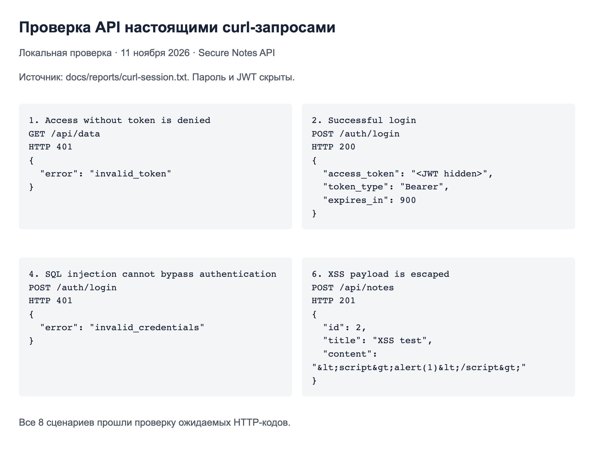
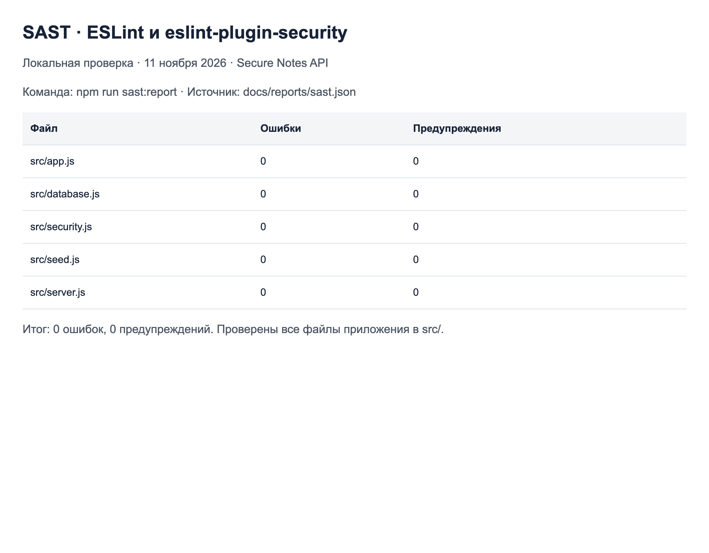
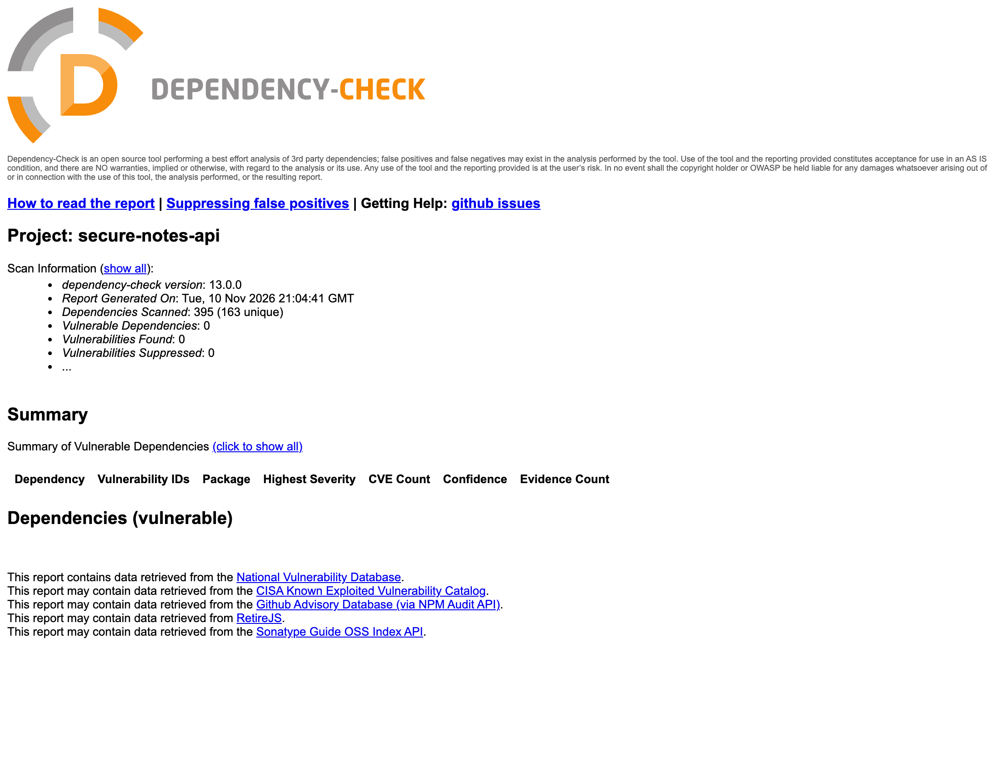

# Защищённый REST API личных заметок

Лабораторная работа № 1 по дисциплине «Информационная безопасность», Университет ИТМО.
Выполнил **Петров Вячеслав Маркович**, группа **P3408**, 2026 год.

API позволяет войти по логину и паролю, получить свои заметки и создать новую.
Стек: Node.js 24, Express 5, встроенный SQLite (`node:sqlite`), `jose` для JWT,
встроенный `crypto.scrypt` для хэширования паролей. Пользователь видит только свои данные.

## Запуск

Нужны Node.js 24 или новее и npm. Для OWASP Dependency-Check дополнительно нужен Docker.

```bash
npm ci
cp .env.example .env
openssl rand -hex 32
# Впишите полученную случайную строку в JWT_SECRET в .env.
```

Создайте пользователя. В Bash пароль можно ввести без отображения и без записи в историю:

```bash
export SEED_USERNAME=slava
read -rs -p 'Пароль (от 12 символов): ' SEED_PASSWORD; echo
export SEED_PASSWORD
npm run seed
unset SEED_PASSWORD
npm start
```

В Zsh вместо строки `read` используйте `read -rs 'SEED_PASSWORD?Пароль (от 12 символов): '; echo`.
Сервер доступен на `http://127.0.0.1:3000`. База `notes.sqlite` создаётся автоматически;
повторный `seed` сохраняет существующий пароль. Демо-паролей в репозитории нет.
`.env`, база данных и `node_modules` исключены из Git. Новые файлы БД создаются с закрытыми правами.

## Методы API

| Метод | Назначение | Авторизация | Успешный ответ |
|---|---|---|---|
| `POST /auth/login` | Вход с `username` и `password` | Не нужна | `200`, JWT и срок действия |
| `GET /api/data` | Получить свои заметки | `Bearer <JWT>` | `200`, массив заметок |
| `POST /api/notes` | Создать заметку с `title` и `content` | `Bearer <JWT>` | `201`, созданная заметка |

Пример входа (значение пароля замените своим; пример не содержит действующих учётных данных):

```bash
curl -sS http://127.0.0.1:3000/auth/login \
  -H 'Content-Type: application/json' \
  -d '{"username":"slava","password":"YOUR_PASSWORD"}'
```

Ответ: `{"access_token":"<JWT>","token_type":"Bearer","expires_in":900}`.
Сохраните токен из ответа в переменную `TOKEN`, затем выполните:

```bash
curl -sS http://127.0.0.1:3000/api/data \
  -H "Authorization: Bearer $TOKEN"

curl -sS http://127.0.0.1:3000/api/notes \
  -H "Authorization: Bearer $TOKEN" \
  -H 'Content-Type: application/json' \
  -d '{"title":"Лабораторная работа","content":"Моя первая заметка"}'

# Проверка отказа без токена: HTTP 401
curl -i http://127.0.0.1:3000/api/data
```

Новая заметка возвращается как `{"id":1,"title":"Лабораторная работа","content":"Моя первая заметка"}`.
Чужие заметки в `GET /api/data` не попадают. Переданный клиентом `owner_id` не используется.

Ошибки всегда имеют JSON-формат: `400` — неверный JSON, тип или длина поля;
`401` — неверные учётные данные либо JWT; `404` — неизвестный маршрут;
`413` — тело больше 8 КиБ; `429` — более 10 попыток входа за минуту с одного IP.
Логин ограничен 64 символами, пароль при входе — 256, заголовок заметки — 120,
текст заметки — 4000. Пустые и состоящие из пробелов значения отклоняются.

## Реализованные меры защиты

### SQL-инъекции

В [src/app.js](src/app.js) все значения передаются параметрами SQLite `?`.
SQL-текст не собирается из пользовательских строк. Например:

```javascript
const user = db.prepare('SELECT id, password_hash FROM users WHERE username = ?').get(username);
```

Логин `' OR 1=1 --` рассматривается как буквальное имя и получает `401`.
Строка `'); DROP TABLE users; --` внутри заметки сохраняется как текст и не удаляет таблицу.
Статический DDL в [src/database.js](src/database.js) не содержит пользовательского ввода.

### XSS

Оба пользовательских поля (`title`, `content`) экранируются `escape-html` при **каждом**
ответе: и после создания, и при чтении. В базе остаётся исходный текст:

```javascript
const serialize = (note) => ({
  id: note.id,
  title: escapeHtml(note.title),
  content: escapeHtml(note.content),
});
```

Например, `<script>alert(1)</script>` возвращается как
`&lt;script&gt;alert(1)&lt;/script&gt;`. Ответ имеет тип `application/json`,
заголовок `X-Content-Type-Options: nosniff` и CSP `default-src 'none'; frame-ancestors 'none'`.
Клиенту следует вставлять такие данные как текст; декодирование сущностей и вставка в
`innerHTML` снова создадут риск XSS. Это экранирование предназначено для HTML-текста,
а не для вставки в JavaScript, CSS или URL.

### Пароли и аутентификация

- В [src/security.js](src/security.js) применяется scrypt: `N=131072`, `r=8`, `p=1`.
  Случайная соль — 16 байт, результат — 64 байта. Формат хранения: `scrypt$salt$hash`.
  Параметры соответствуют [рекомендации OWASP](https://cheatsheetseries.owasp.org/cheatsheets/Password_Storage_Cheat_Sheet.html).
  Сравнение выполняется `timingSafeEqual`. Ни исходный пароль, ни хэш не возвращаются в API.
- После входа `jose` выдаёт JWT HS256 на 15 минут с полями `sub`, `iat`, `exp`,
  `iss=secure-notes-api`, `aud=secure-notes-client`. При проверке сервер явно разрешает
  только HS256, требует обязательные поля и проверяет issuer, audience, срок и ID пользователя.
  Токены без подписи (`alg: none`), с другой подписью или алгоритмом отклоняются.
- Middleware на префиксе `/api` проверяет JWT и существование пользователя для всех
  защищённых маршрутов. Владельцем заметки становится пользователь из проверенного токена.
  И создание, и чтение ограничены этим владельцем.
- Секрет загружается из окружения/`.env`; при длине меньше 32 байт запуск запрещён.
  Для рабочего секрета используется генератор случайных чисел, а не запоминаемая фраза.
- Неизвестный пользователь и неверный пароль получают одинаковый `401 invalid_credentials`.
  Для неизвестного пользователя тоже вычисляется scrypt, чтобы уменьшить различие времени ответа.
  Ограничитель входа возвращает `429` и `Retry-After`. Ответы API не кэшируются (`no-store`).

## Проверки и CI

```bash
npm test             # 18 тестов API и безопасности
npm run demo         # 8 настоящих curl-сценариев на временном локальном сервере
npm run sast         # ESLint + eslint-plugin-security
npm run audit        # аудит production- и dev-зависимостей
sh scripts/dependency-check.sh  # OWASP Dependency-Check через Docker
```

В [test/api.test.js](test/api.test.js) проверяются вход, SQLi, XSS, изоляция заметок,
соль и хэши паролей, обязательность токена, поддельные/просроченные/неполные JWT,
неверные алгоритм/issuer/audience, отсутствующий пользователь, валидация и ограничения запросов.
Тесты запускают HTTP-сервер на случайном локальном порту и не затрагивают рабочую БД.

[.github/workflows/ci.yml](.github/workflows/ci.yml) запускается на **каждый push и pull request**,
а также вручную. У pipeline три задачи:

| Задача | Проверка | Условие отказа | Артефакт |
|---|---|---|---|
| API and security tests | `node --test` на Node.js 24 | Любой провал теста | Лог задачи |
| SAST ESLint Security | Код `src/`, правила безопасности, запрет eval | Ошибка или предупреждение | `sast-report`, JSON |
| SCA OWASP Dependency Check | npm audit и OWASP Dependency-Check | npm high/critical или CVSS ≥ 7 | `sca-report`, JSON и HTML |

SAST анализирует исходный код без запуска приложения. npm audit является SCA, поэтому
для анализа самого кода отдельно подключён ESLint Security. Lock-файл фиксирует
прямые и транзитивные зависимости с контрольными суммами; используется публичный npm-реестр.

Официальный Docker-образ OWASP содержит предзагруженную базу NVD и использует также Node Audit Analyzer.
В CI и локально запускается один скрипт `scripts/dependency-check.sh`; образ закреплён по digest.
OSS Index отключён, так как требует отдельную учётную запись; NVD и Node Audit остаются включены.
Сканируются и production-, и dev-зависимости из lock-файла. Исключения `node_modules` и `docs`
не отключают анализ lock-файла, а предотвращают повторный анализ установленного кода и архивных отчётов.
Подавления уязвимостей не настроены. Отчёты загружаются в Actions и при неуспешной проверке.
Ошибки сети/сканера не маскируются. Workflow имеет только разрешение `contents: read`.

## Локальные результаты

Проверка от 11 ноября 2026 года: 18 тестов пройдено; 8 curl-сценариев пройдено;
ESLint Security — 0 ошибок и 0 предупреждений; npm audit — 0 уязвимостей в 155 зависимостях;
OWASP Dependency-Check — 0 уязвимостей и 0 подавлений.
Эти скриншоты относятся к **локальному запуску**.







Протоколы: [curl](docs/reports/curl-session.txt), [тесты](docs/reports/tests.txt),
[SAST JSON](docs/reports/sast.json), [npm audit](docs/reports/npm-audit.json),
[OWASP HTML](docs/reports/dependency-check-report.html).

## GitHub Actions

[Репозиторий](https://github.com/petrovviacheslav/lab1-infobez) ·
[Запуски Security CI](https://github.com/petrovviacheslav/lab1-infobez/actions/workflows/ci.yml) ·
[Успешные запуски](https://github.com/petrovviacheslav/lab1-infobez/actions/workflows/ci.yml?query=is%3Asuccess).

Первый запуск новой конфигурации появится после push. Ссылка на конкретный успешный
run и скриншоты из Actions добавляются после его завершения; локальные результаты выше
не являются подтверждением запуска на GitHub.

## Границы учебного проекта

По умолчанию сервер слушает loopback. Для публикации нужны HTTPS и ограничение
параллельных входов с учётом затрат scrypt. Logout, refresh и отзыв JWT не реализованы;
токен действует до `exp`. Лимит входа хранится в памяти одного процесса и сбрасывается
при перезапуске; для нескольких экземпляров нужен общий store.
Регистрация и интерфейс не входят в задание. Сканеры выявляют только известные им проблемы на дату проверки.
